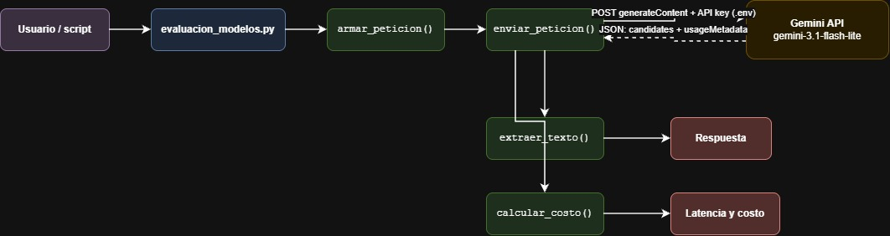

# Decisión de arquitectura: elección de modelo

## Modelo elegido

**`gemini-3.1-flash-lite`**, consumido vía REST (`generateContent`) desde [`src/consumir_gemini.py`](../src/consumir_gemini.py).

## Diagrama de arquitectura

## Comparación de candidatos

Prueba: prompt `"Confirma la conexion"`, 4 peticiones por modelo (26-10-2026), con los precios por token que define `evaluacion_modelos.py`.

| Modelo | Peticiones OK | Latencia promedio | Tokens (entrada / salida / razonamiento) | Costo promedio por petición | Disponibilidad | Respuesta |
|---|---|---|---|---|---|---|
| `gemini-3.6-flash` | 1 / 4 | 9,65 s | 4 / 22 / **265** | $0,0000865 | ❌ 429: se agotó la cuota diaria del Free Tier (20 req/día) | "¡Conexión confirmada! Todo está funcionando correctamente." |
| **`gemini-3.1-flash-lite`** | **4 / 4** | **4,11 s** (2,02 – 7,42 s) | 4 / ~21 / **0** | **$0,0000818** | ✅ Estable | "Conexión confirmada. Estoy listo y operativo." |
| `gemini-3.8-flash` | 0 / 11 | — | — | — (el precio por token más alto: $2,50 / $10,00 por 1M) | ❌ 503: servicio saturado | — |

## Justificación

- **Disponibilidad:** es el único modelo que respondió las 4 peticiones sin errores.
- **Latencia:** su promedio de 4,11 s es menos de la mitad de los 9,65 s de `gemini-3.6-flash`.
- **Costo real:** no genera tokens de razonamiento, así que el costo por petición resulta el más bajo, aunque su precio por token es mayor que el de `3.6-flash`.
- **Calidad suficiente:** para respuestas cortas y directas como estas, la respuesta es correcta y equivalente a la de los otros modelos.

## Alternativa descartada y por qué

**`gemini-3.6-flash`**: en precio por token es el más barato ($0,10 / $0,30 por 1M), pero en la práctica sale más caro y más lento:
- Usó **265 tokens de razonamiento** para una respuesta de 22 tokens. Eso multiplica el costo de salida por unas 13 veces y explica la latencia de casi 10 s.
- Agotó la cuota diaria del Free Tier (HTTP 429) después de 1 petición, así que no sirve para pruebas repetidas.

`gemini-3.8-flash` también queda descartado: no respondió ninguna de las 11 peticiones (HTTP 503) y tiene el precio por token más alto (25 veces la entrada y 33 veces la salida de `3.6-flash`).

> Nota: la muestra es pequeña (1 prompt, 4 repeticiones) y estuvo afectada por límites de cuota y saturación. Conviene repetir la medición cuando se reinicie la cuota.
